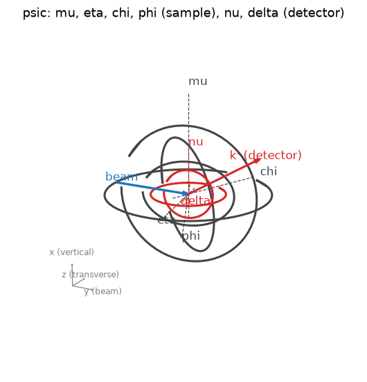
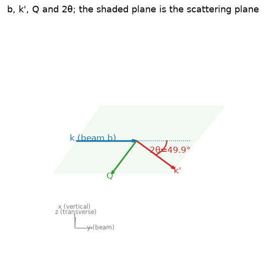
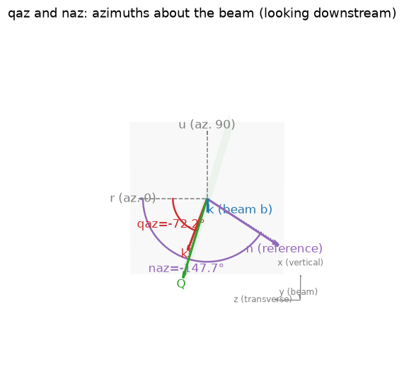
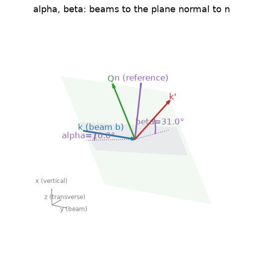
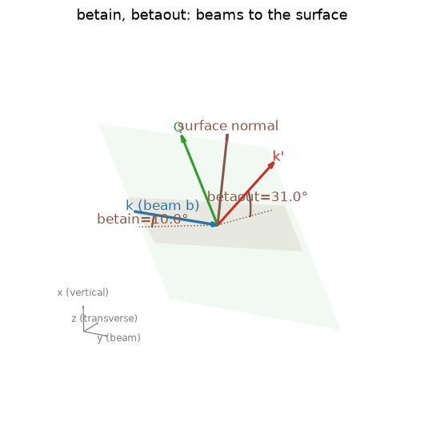
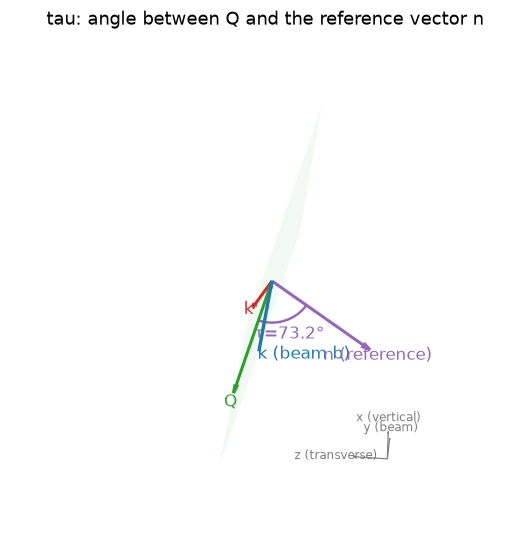
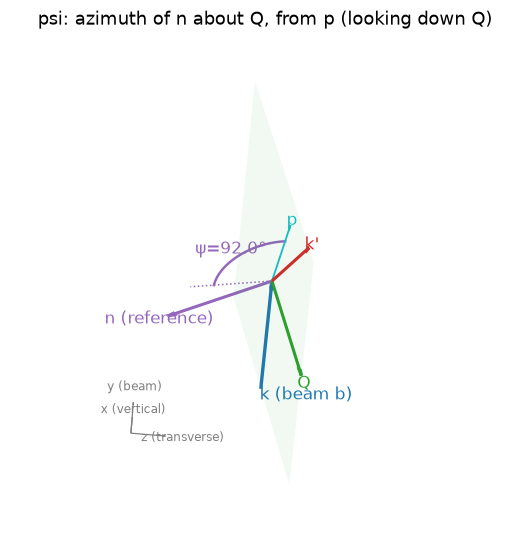
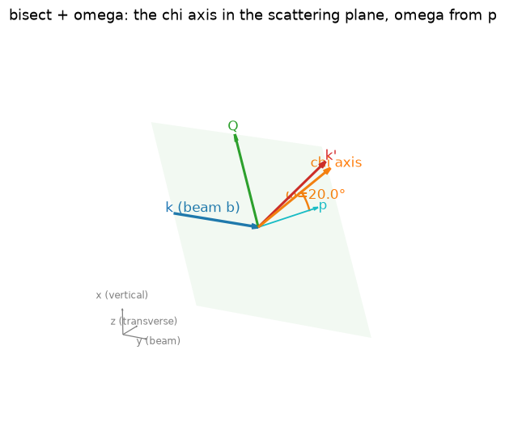

# Virtual angles

Every quantity below is defined from lab-frame vectors of one position, so it
means the same thing on any geometry hklforge can describe. For the psic
six-circle the definitions are those of diffcalc (You 1999); the code is
[`hklforge/virtual.py`](../src/hklforge/virtual.py), and
`Diffractometer.pseudo(angles)` returns all of them. Every value was checked
against diffcalc's `get_virtual_angles` at 300 random positions: largest
difference 3e-13 deg (see [verification](verification.md)).

The figures are drawn by `hklforge.draw.draw(d, angles, show=[...])` for a real
solution (cubic crystal, a = 4 Å, 9 keV, reflection (1,1,2)); regenerate them
with `python docs/make_figures.py`.

## The vectors

| symbol | what | in code |
|---|---|---|
| **b** | incoming beam direction (unit) | `geometry.beam` |
| **k'** | outgoing beam direction (unit), = D b | `geometry.k_out(angles)` |
| \|k\| | 2π/λ, in 1/Å | `Diffractometer.k` |
| **Q** | scattering vector, = \|k\| (k' − b); in Bragg condition Q = R UB h | `geometry.q_lab(angles, k)` |
| **n** | reference vector, phi frame; R n in the lab | `Diffractometer(reference=...)` or `reference_hkl=` |
| **s** | surface normal, phi frame; R s in the lab | `surface=` or `surface_hkl=` |
| **r, u** | azimuth frame about the beam: azimuth = atan2(v·u, v·r) | `geometry.azimuth_frame()` |
| **p** | the beam's direction across Q: unit(b − (b·Q̂) Q̂), lies in the scattering plane, normal to Q | `virtual.scattering_frame` |
| **e** | lab axis of the *bisect circle* (psic: chi), moved by the circles outside it | `virtual.bisect_axis` |

R is the sample rotation (phi frame → lab), D the detector rotation. With `*_hkl`
a vector is given as reciprocal-lattice indices: n = UB h, normalised.

For psic, b = y, x is vertical and z transverse; r = z and u = x, so an azimuth
of 90° means "pointing up". Another geometry sets `azimuth_zero` in its YAML
(default: the lab axis after the beam in cyclic order) and `bisect_circle`.

## Definitions

| name | definition | range |
|---|---|---|
| `theta` | half the scattering angle: cos 2θ = b·k' | 0..90 |
| `ttheta` | 2θ | 0..180 |
| `qaz` | azimuth of the scattering plane about the beam: atan2(k'·u, k'·r) | ±180 |
| `naz` | azimuth of the reference vector about the beam: atan2(n·u, n·r) | ±180 |
| `alpha` | incidence on the plane normal to n: sin α = −b·n | ±90 |
| `beta` | exit from the plane normal to n: sin β = k'·n | ±90 |
| `betain` | as alpha, with the surface normal: sin = −b·s | ±90 |
| `betaout` | as beta, with the surface normal: sin = k'·s | ±90 |
| `tau` | angle between Q and n: cos τ = Q̂·n | 0..180 |
| `psi` | azimuth of n about Q, measured from p: atan2(n·(Q̂×p), n·p) | ±180 |
| `omega` | direction of the bisect-circle axis in the scattering plane, from p towards Q: atan2(e·Q̂, e·p) | ±180 |
| `bisect` | a condition, not an angle: e lies in the scattering plane, e·(b × Q̂) = 0 | - |

Signs: alpha and betain are positive when the beam comes in from the side the
normal points to (grazing incidence on a surface facing the beam); beta and
betaout are positive when k' leaves on that side.

### 2θ and the scattering plane

The scattering plane holds b, k' and Q. Q bisects the angle between −b and k',
so Q makes 90° + θ with the beam: b·Q̂ = −sin θ. That is the Bragg condition
the solver uses: **b · R q = −|q|²/(2|k|)**.

### qaz and naz

Seen looking downstream: qaz is where the scattering plane points about the
beam (psic: 90° = vertical scattering with delta, 0° = horizontal with nu), naz
the same for the reference vector. naz is undefined (NaN) when n is along the
beam.

### alpha, beta, betain, betaout

The angles between each beam and the plane normal to the vector (the shaded
patch). For a surface normal that is the usual grazing incidence / exit angle.
Because k' = b + Q/|k|, the exit angle follows from the incidence angle and
hkl: sin β = −sin α + (Q·n)/|k|. Hence **at most one of these can be held**,
and `a_eq_b` / `bin_eq_bout` (α = β) is just sin α = −(Q·n)/(2|k|).

### tau and psi

tau is fixed by the crystal (the angle between q and n in the phi frame); psi
is the rotation of n about Q, counted from p, the in-plane direction normal to
Q that points along the beam's direction of travel. psi = 0 puts n in the
scattering plane, tilted from Q towards p. Undefined when n ∥ Q (tau = 0 or 180) or Q ∥ b.
libhkl's `psi_constant_*` modes use the same convention (checked, see
[verification](verification.md)).

### omega and bisect

e is the axis of the bisect circle (psic: chi) after the circles outside it
(psic: mu, eta) have turned it. `bisect` asks for e to lie in the scattering
plane; `omega` is then the angle from p to e towards Q, so e = cos ω p + sin ω Q̂.
**omega = 0 with bisect is the classic four-circle bisecting position**: the chi
axis normal to Q. In a vertical four-circle (fourcv) the chi axis always lies
in the scattering plane, so there `omega` alone gives bisecting.

diffcalc writes the same constraint through sin(θ + ω) formulas; that formula
covers −90 < ω < 90. libhkl's `bissector_*` modes are omega = 0 *or* 180 (chi
axis normal to Q, either way round).

## Which virtual angles can be held, and what each fixes

| held | fixes | group |
|---|---|---|
| a circle | its angle | - |
| `betain`, `betaout`, `bin_eq_bout`, `alpha`, `beta`, `a_eq_b` | one projection of x = Rᵀb (the beam seen from the sample) | x |
| `psi` | x completely, together with Bragg | x |
| `h2` (second reflection in Bragg) | one projection of x | x |
| `qaz` | k' (2θ is given by hkl) | detector |
| `naz` | the azimuth of R n: m·R n = 0 with m = −sin(naz) r + cos(naz) u | sample |
| `bisect`, `omega` | the bisect-circle axis e (outer circles only) | axis |

Bragg already uses one of the two degrees of freedom of x, so **at most one
x-group constraint** can be held. `theta`, `ttheta` and `tau` follow from hkl
and the crystal and cannot be chosen. How these combine into solvable modes is
in [modes](modes.md).

Units: degrees in and out, |k| = 2π/λ (the 2π convention of diffcalc and
libhkl), UB in the phi frame with q = UB h, |q| = 2π/d.
